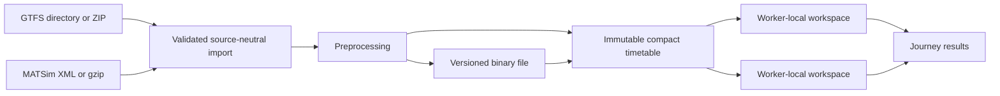

<!-- Explains architectural decisions, performance invariants, and the path toward stronger routing algorithms. -->
# Architecture and performance decisions

## Data flow

Readers understand source semantics; the scan does not know XML, ZIP or CSV. Preprocessing
normalizes trips into connections and walks into CSR arrays. `Engine` shares a single timetable
with the query workers. No mutex protects the shared timetable and no runtime query modifies it.
Thread-local scratch belongs to a worker and can be recycled after different queries/engines;
all touched labels and ride states are reset before reuse.

## Why start with CSA?

It is compact, inspectable and has an independent correctness oracle. A chronological scan
keeps source data contiguous in memory and avoids per-edge Java-style objects. Layered labels
bound boardings while keeping earliest arrivals. The first implementation intentionally does
not copy SwissRailRaptor's full generalized-cost behavior. That distinction must remain explicit
in future integration work.

A weak-component index rejects structurally disconnected queries before scanning. Safe off-vehicle
and same-trip dominance prune unnecessary boarding layers, while ride continuation states preserve
no-boarding/no-alighting semantics.

The scan uses binary search to skip departed connections, bounded horizons, an incumbent arrival
cutoff when full Pareto output is disabled, sparse touched-label reset, a shared spatial index
during walking-link generation, and compact native integers. Stable sorting fixes tie order.
Walking closure and zero-duration event batches are correctness requirements, not optional
optimizations. Path nodes are immutable so later label improvements cannot corrupt previously
recorded itineraries.

## Speedups that can be added safely

1. Benchmark a Swiss-sized timetable and profile scan time, walking relaxations, label writes,
   reconstruction, memory bandwidth and worker scaling separately.
2. Evaluate reusable destination-specific bounds, route/event indexes and bounded trip-based
   searches against the reference oracle. SIMD, prefetching and unsafe code need evidence first.
3. Develop richer labels before adding walking preferences, fares, mode costs or other criteria.
4. Implement FLASH-TB only as an explicitly validated trip-based alternative. Destination-cell
   topology flags in this version are a conservative experiment and do not implement FLASH-TB's
   precomputed event-transfer flags or its pruning proofs.

Published FLASH-TB results motivate the roadmap, not a performance claim for this project:
https://arxiv.org/abs/2312.13146 and https://github.com/TransitRouting/FLASH-TB.

## Reader extension contract

A new reader produces stops, trips with ordered calls, and optional directed footpaths. It must
validate selected-date semantics and reject unsupported restrictions. All sources enter the same
preprocessor. Do not introduce a second GTFS-only routing engine or a MATSim-specific hot loop.
Adding a public read-options struct is preferable to passing the entire global config to readers.

## Binary evolution

The current format is a framed Postcard payload with a BLAKE3 integrity checksum. It removes text
parsing and repeated preprocessing, but is not mmap. A later mapped-array format should use a
versioned manifest, fixed-width little-endian section layouts, checked offsets and safe owned
mapping lifetimes. Benchmark startup and resident memory before changing the storage abstraction.

## Future integration

An embedded library and a local server should both call the same core. Transport formats,
process startup, request IDs, batching and Java itinerary conversion belong in adapters.
Preprocessed data can later include a feed/config fingerprint for automatic cache reuse.
No server or runtime Java dependency is included now. The weighted query API accepts multiple
access/egress stops; coordinate candidate generation currently belongs to the benchmark adapter.
Street access can replace this adapter without changing timetable reader ownership.

## Weighted objective

`weighted` scans the immutable connection array in boarding rounds. Off-vehicle frontiers retain
time, base cost, last mode, reconstruction path, access choice and (only when needed) first
boarding time. Sufficient dominance compensates the earlier label for the time difference at
the largest waiting/in-vehicle rate, preserving choices when boarding during vehicle dwell.
Trip states compare costs at the same event, with first-boarding context for duration penalties.
Nonnegative rates permit incumbent pruning and a minimum-rate elapsed-time lower bound.
Each transfer uses one direct edge; final walking may extend to an egress candidate. There is
no arrival-only pruning or arbitrary cap on frontier labels. Prepared data and cost matrices
are shared; reusable workspaces are private to each worker. This favors correctness and clear
extension boundaries over claiming a FLASH-TB implementation or identical Raptor heuristics.
