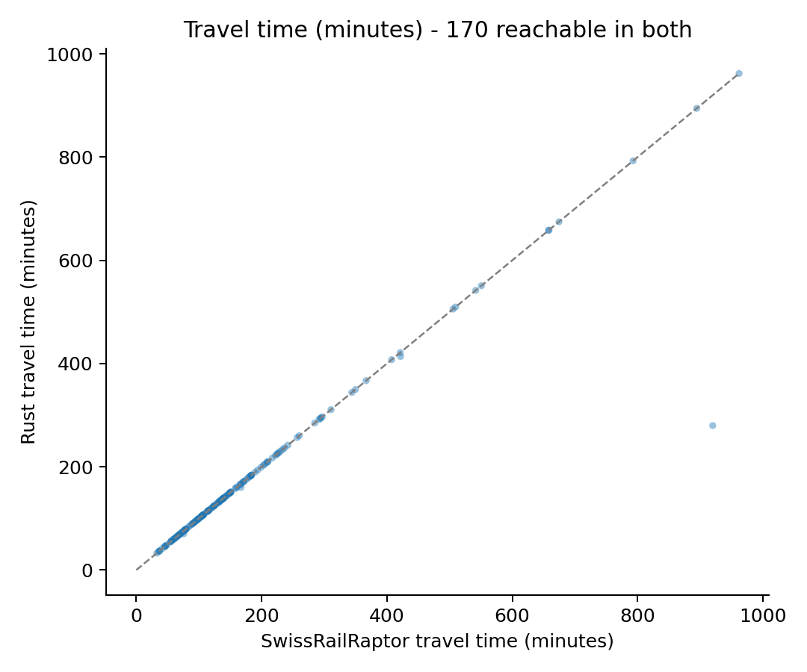
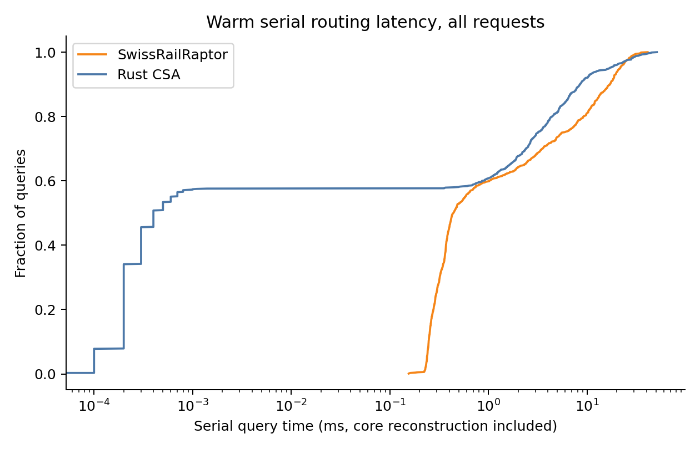
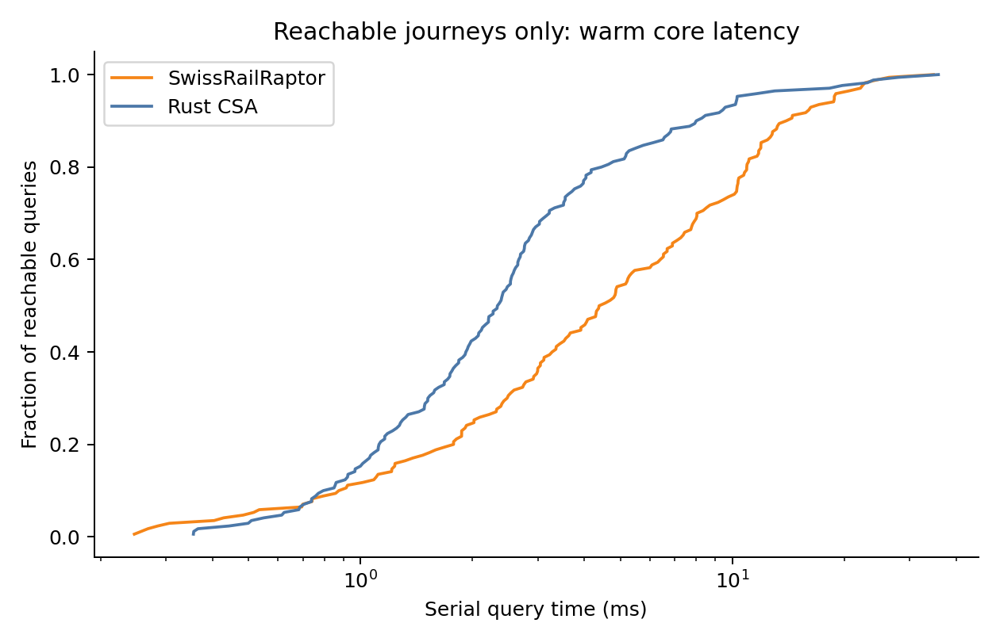
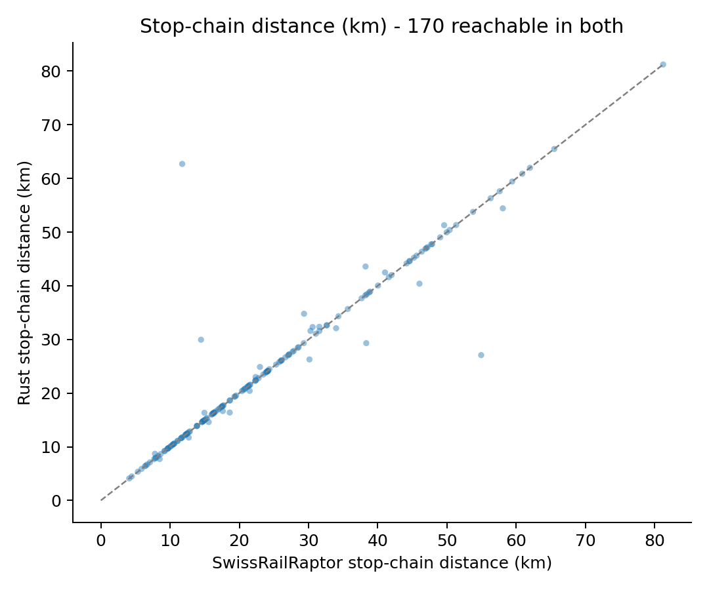
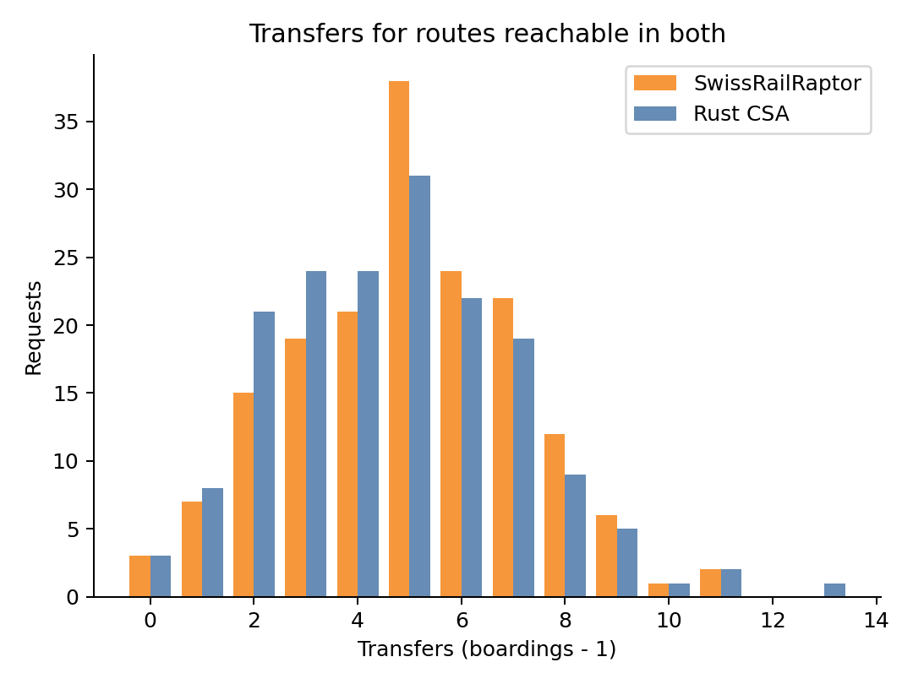
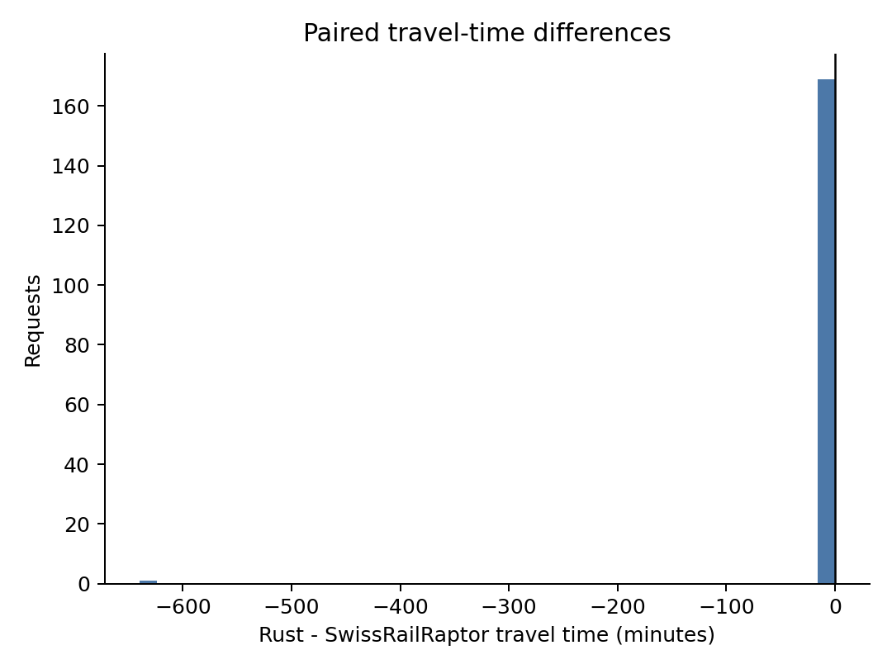
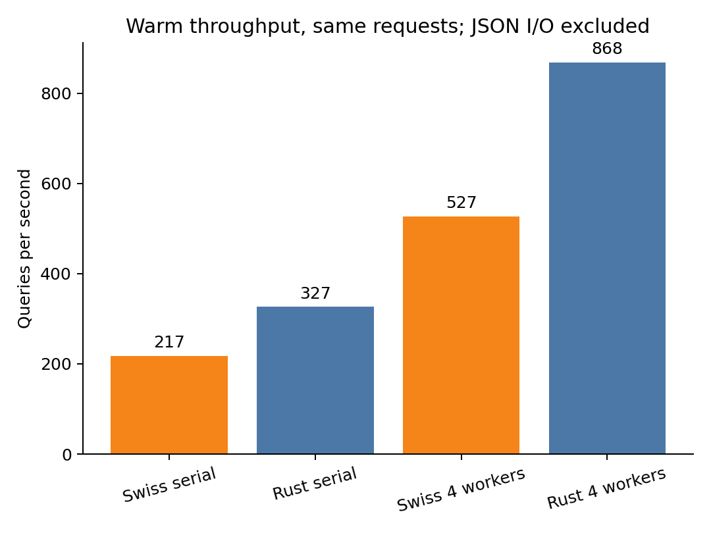
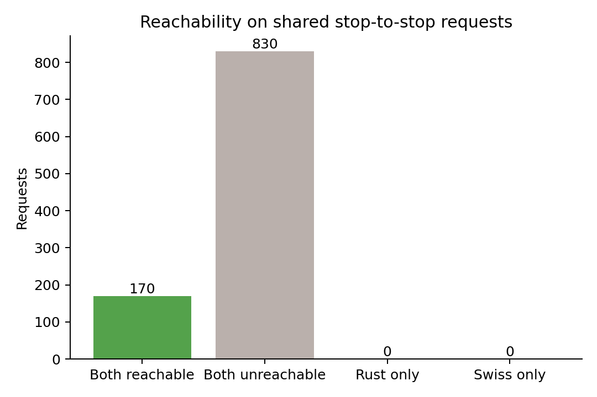

<!-- Reports measured results and limits of the controlled Geneva example. -->
# Geneva: Rust CSA and SwissRailRaptor

1000 shared requests; seed 42; 4 workers; 2000 warmup queries per mode.

| Engine | Serial total (s) | Parallel total (s) | Median query (ms) | p95 query (ms) | Reachable |
|---|---:|---:|---:|---:|---:|
| swiss | 4.599 | 1.896 | 0.4413 | 21.5347 | 170 |
| rust | 3.061 | 1.152 | 0.0004 | 16.7688 | 170 |

Reachability: {"both": 170, "neither": 830, "rust_only": 0, "swiss_only": 0}

Paired route agreement: {"count": 170, "within_1s": 166, "median_abs_difference_s": 0.0, "max_abs_difference_s": 38406.0, "same_transfer_count": 118}

Optimized Rust versus initial Rust arrival/boarding equality: {"matching_arrival_and_boardings": 1000, "changed_request_ids": []}

Median reachable-query latency (ms): {"swiss": 4.469099999999999, "rust": 2.3506}

## Interpretation

Input normalization: 1 malformed route(s) excluded; 6704 unused endpoint offsets normalized. Detailed IDs/reasons are in metadata.json. Original source files are unchanged.

This is a controlled **core stop-to-stop** benchmark on the real schedule, not a full simulation or the original mode-choice configuration. Walking between distinct stop IDs and coordinate access/egress are disabled. Pair-specific transfer overrides are replaced with the same constant same-stop buffer for both engines. Uniform time costs are used; mode/fare preferences are absent. Rust permits 21 boardings; SwissRailRaptor retains its normal round limit and additional-round stopping heuristic. Equal-arrival tie choices may differ.

Distances sum straight segments between successive scheduled stops on the selected services, not network-link distances or origin-destination chords. Ambiguous repeated-stop segments are counted in the CSV. Distances are computed outside timing by the same analysis code. Quality figures use only requests reachable in both; latency/throughput include all requests.

Serial timing includes each core search and internal reconstruction, excluding JSON I/O. Parallel timing includes scheduling and result collection (Java executor versus Rayon). Neither phase uses a route-result cache. Loading is separate; Java also loads the network, so startup is not equivalent work. Java uses -Xmx10g; Rust is optimized release. Exact inputs, hashes, CPU/OS and original settings are in metadata.json.

Most requests are unreachable under the no-interstop-walking protocol. Rust's component rejection can strongly affect aggregate throughput; inspect the reachable-only latency figure as well. Restoring realistic walking may connect many components and change the comparison.

This repeated-query harness is not JMH/Criterion and does not establish whole-simulation speedup. See ../README.md for reproduction and limitations.

## Arrival-time differences over one second

All returned reachable itineraries were checked against the timetable and transfer buffer. These are valid returned journeys, not a proof of equivalent optimality. The differing stopping/tie policies remain part of the benchmark.

| Request | Rust time (min) | Swiss time (min) | Rust transfers | Swiss transfers |
|---|---:|---:|---:|---:|
| 138 | 413.78 | 421.78 | 13 | 8 |
| 227 | 160.03 | 167.03 | 8 | 5 |
| 404 | 70.20 | 75.65 | 6 | 1 |
| 993 | 279.83 | 919.93 | 6 | 3 |

