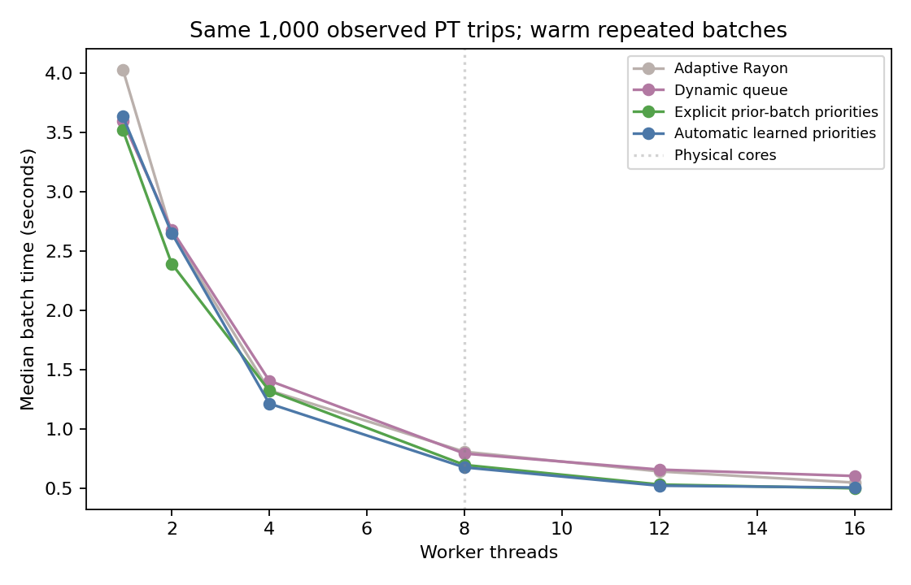
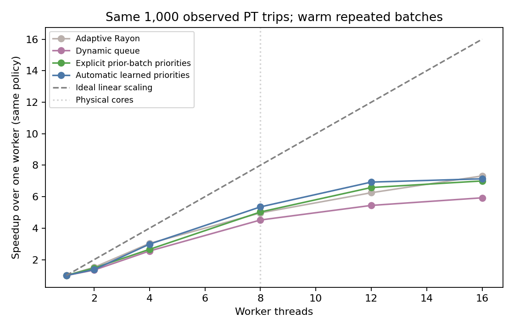
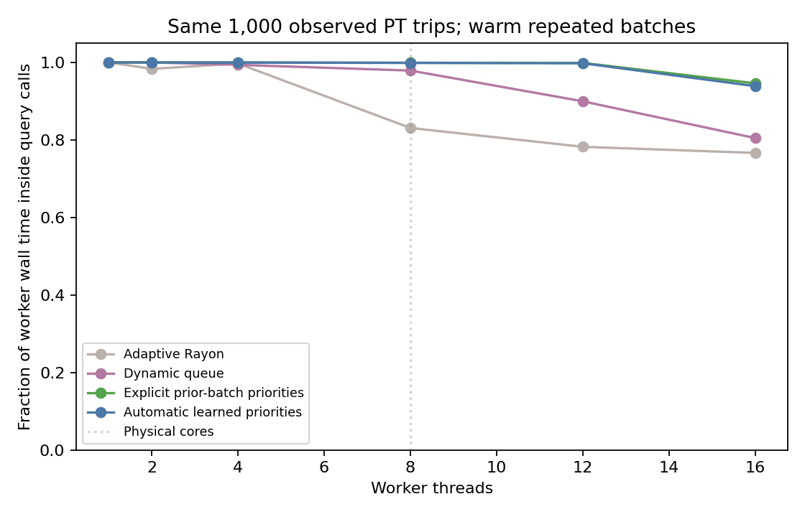
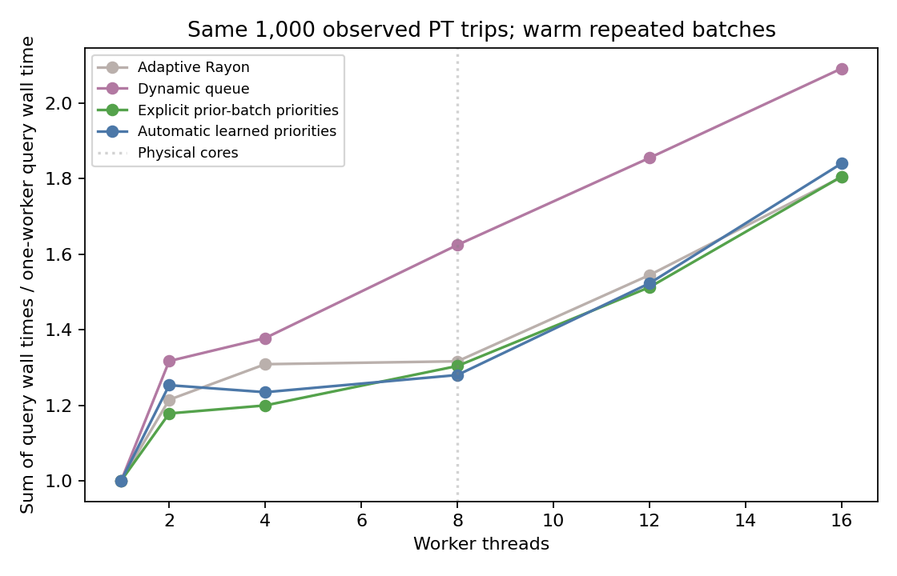

<!-- Reports measured routing parallelism, scheduling trade-offs and hardware limits. -->
# Geneva parallel scaling

Machine: AMD Ryzen 7 PRO 6850U with Radeon Graphics     ; 8 physical cores, 16 logical threads. Windows-11-10.0.26200-SP0.

Three timed repetitions per point after two complete warmup batches; medians below. Each row routes the same 1,000 requests, including reconstruction. Loading, result validation and profiling passes are separate. No route-result cache is used. All schedulers and worker counts produced the same ordered route fingerprint, covering legs, costs, arrivals, boardings and endpoint choices.

| Workers | Adaptive Rayon (s) | Dynamic queue (s) | Prior-batch priorities (s) | Dynamic speedup | Priority speedup |
|---|---:|---:|---:|---:|---:|
| 1 | 4.028 | 3.593 | 3.517 | 1.00x | 1.00x |
| 2 | 2.653 | 2.679 | 2.393 | 1.34x | 1.47x |
| 4 | 1.327 | 1.408 | 1.323 | 2.55x | 2.66x |
| 8 | 0.810 | 0.795 | 0.699 | 4.52x | 5.03x |
| 12 | 0.644 | 0.660 | 0.534 | 5.45x | 6.58x |
| 16 | 0.550 | 0.606 | 0.502 | 5.93x | 7.00x |

## Default automatic scheduling

| Workers | Auto median (s) | Auto speedup | Query-wall occupancy |
|---|---:|---:|---:|
| 1 | 3.632 | 1.00x | 100.0% |
| 2 | 2.651 | 1.37x | 100.0% |
| 4 | 1.216 | 2.99x | 99.9% |
| 8 | 0.678 | 5.35x | 99.8% |
| 12 | 0.524 | 6.93x | 99.8% |
| 16 | 0.509 | 7.14x | 93.8% |

## What changed

The default auto policy starts with adaptive Rayon for cold weighted work, learns a bounded history of query fingerprints and execution costs, then selects a dynamic priority queue once at least half a batch is familiar. No itineraries or person attributes are stored in that history. Setting execution.work_estimate_capacity to zero disables automatic learning. Dynamic claiming uses a persistent work loop on each worker. One loop runs on each Rayon worker and claims one query at a time through an atomic counter. Results are published into per-input slots and returned in original order. Timetables/indices remain shared and workspaces remain thread-local. Arrival-only routing retains adaptive Rayon splitting by default, avoiding fine-grained dispatch overhead for very short/unreachable queries.

For repeated work, callers can supply prior query costs. Expensive jobs are then claimed first. The priority measurements obtain estimates from actual preceding parallel warmup work, not from serial timings or the timed batch being predicted. Automatic mode also includes fingerprint lookup, score updates and lightweight clocks inside the measured batch time. Initial geometry/timetable estimates are also available but were not consistently helpful in pilots, so they are optional. Explicit-priority mode requires caller-aligned estimates; auto mode uses its documented bounded advisory history. Neither mode caches routes.

## Interpreting scaling

Ideal linear scaling is a reference line, not a guarantee. This host has fewer physical cores than logical threads. At higher concurrency, threads share execution resources, cache, memory bandwidth and power/clock budgets. The profiling pass reports the sum of query wall times, including OS descheduling: it cannot identify which hardware effect dominates. Worker wall occupancy is time inside query calls divided by total worker wall capacity, not measured CPU utilization. The profiling pass is separate from the timing medians.

A near-full work queue can coexist with sublinear throughput if queries themselves take longer under concurrency. The longest individual query also bounds batch completion because one route stays single-threaded. Use large batches and a single shared routing pool; creating one pool per caller can oversubscribe the machine. Coordinate the Rust pool with other application worker pools when integrating with MATSim.

## Scope

This is one mobile CPU and one Geneva query mix, not a scaling guarantee for a 24/48-core server. Rerun on the target server. Trial timings for fine-grained stealing, geometry estimates and optional mimalloc are retained in pilot/queue/mimalloc JSON files. The alternate allocator showed no consistent improvement here; system allocation remains the default. The fast-allocator Cargo feature affects application binaries only, never installs an allocator in the library, and requires target-specific measurement.

