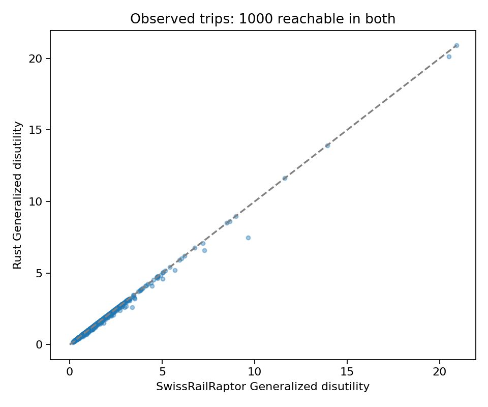
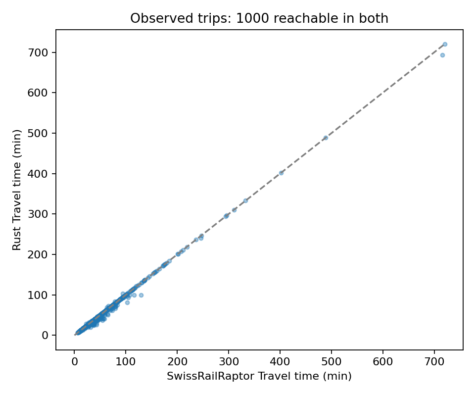
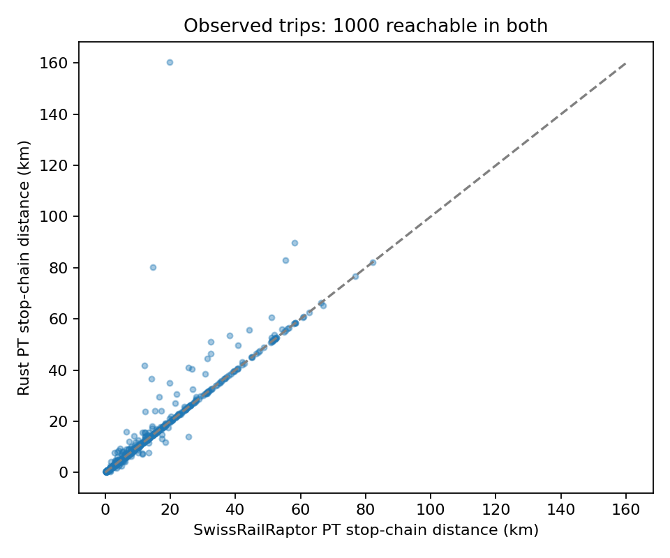
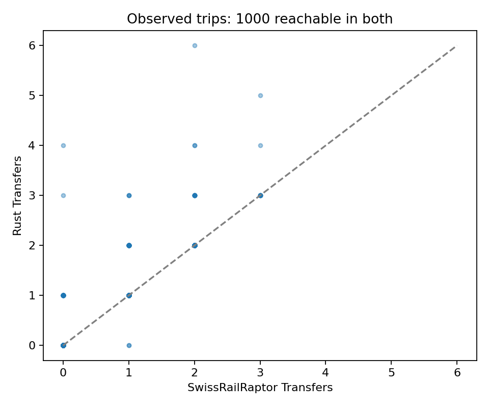
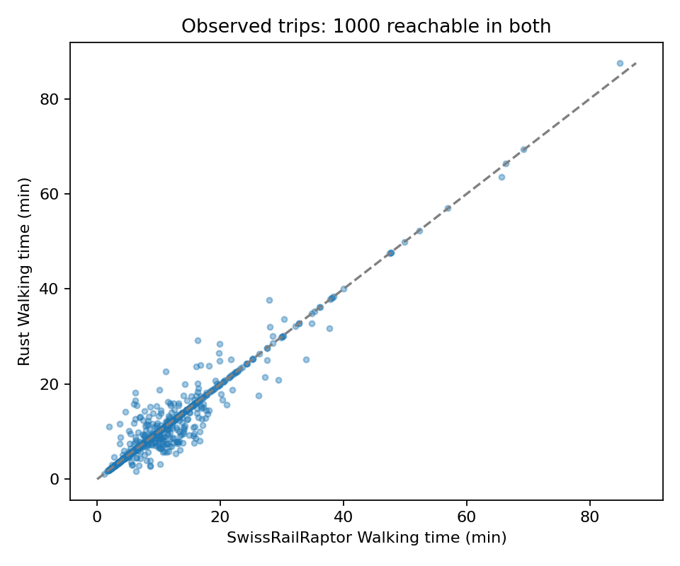
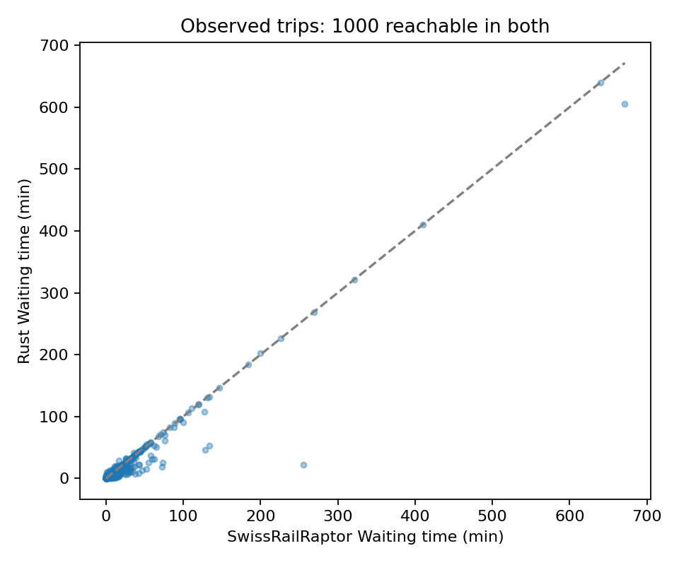
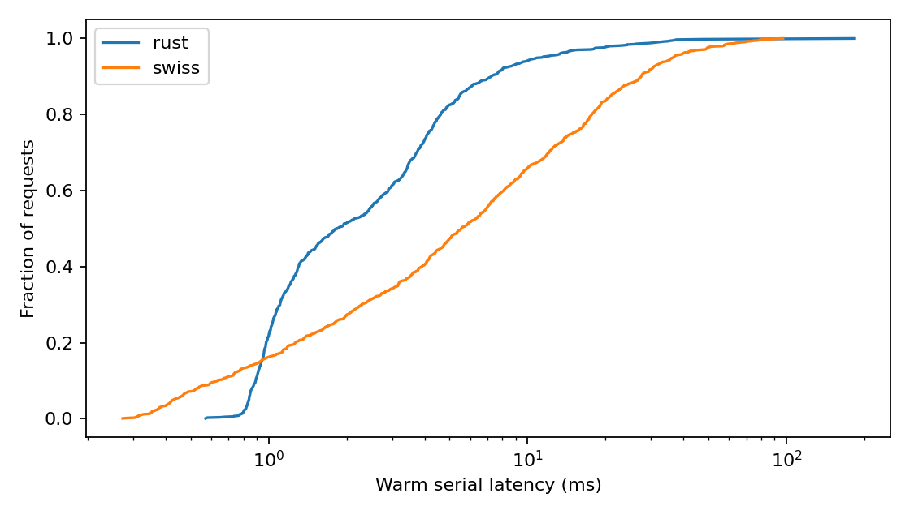
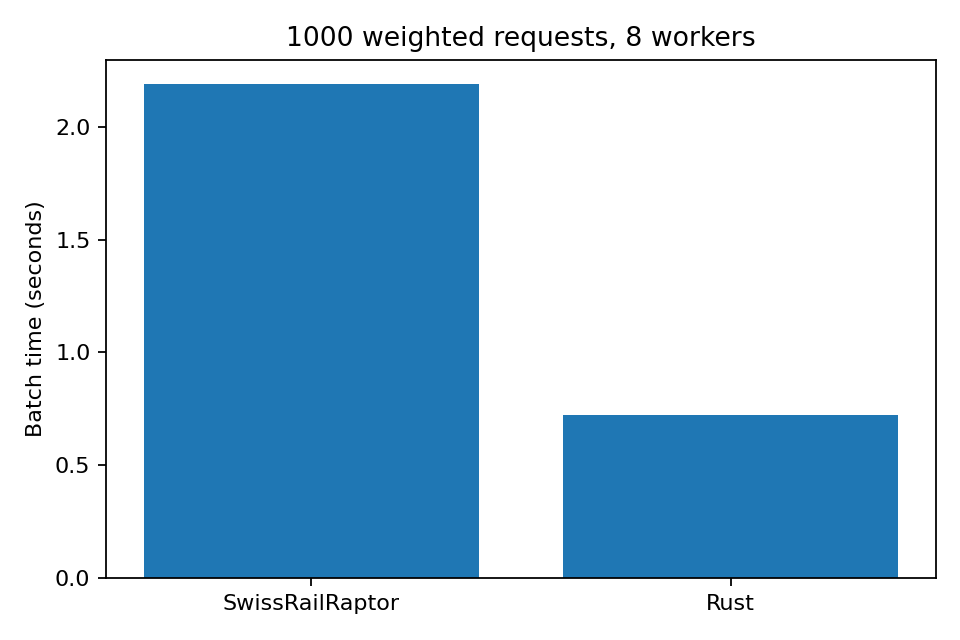

<!-- Reports measured routing comparisons on sampled observed Geneva PT trips. -->
# Observed-trip comparison with Eqasim costs

1000 sampled trips from 66028 eligible observed pt trips; seed 42; 8 workers.

Both routers use **8 routing workers**, with **2000 warmup queries per serial/parallel phase**. Rust automatic scheduling learns execution-cost hints during parallel warmup; every measured route is recomputed. [Reproducible command and execution details](RUN.md).

| Engine | Serial (s) | Parallel (s) | Median latency (ms) | p95 (ms) | Max (ms) |
|---|---:|---:|---:|---:|---:|
| rust | 3.843 | 0.724 | 1.847 | 11.352 | 182.075 |
| swiss | 10.701 | 2.189 | 5.548 | 36.497 | 96.973 |

## Search work and preprocessing

Shared weighted index: 2.56 MiB; 16642 relaxed edges, 16095 physical transfer entries and 274052 indexed platform departure events. This excludes the base timetable, cost settings, construction temporaries and worker workspaces.

| Work counter | Before | Optimized |
|---|---:|---:|
| connections_scanned | not recorded | 156053604 |
| labels_improved | not recorded | 1049823 |
| boarding_rounds | not recorded | 2954 |
| labels_pruned_by_history | not recorded | 953551 |
| labels_pruned_by_bound | not recorded | 16072179 |
| transfers_considered | not recorded | 6226617 |
| transfers_pruned | not recorded | 2847395 |
| path_nodes | not recorded | 3540928 |
| bound_settled_stops | not recorded | 4080175 |

Destination bounds are recomputed inside every timed query. They ignore waiting, penalties and restrictions to provide optimistic costs. Cross-round dominance preserves previous mode and, when needed, first boarding time. Transfers are sorted once; platform departure/mode indices reject infeasible or provably too costly next boardings. Later express/overtaking services remain searchable. All four exact accelerations default on and can be disabled independently under routing.search. No landmarks, destination-cell arc flags or transfer hierarchy are claimed by this implementation.

All returned journeys were validated against the schedule, shared transfer graph and endpoint walking times. Rust's reported cost matches the independent scorer.

Reachability and agreement: `{"requests": 1000, "reachable_both": 1000, "rust_only": 0, "swiss_only": 0, "neither": 0, "all_returned_paths_validated": true, "paired": {"within_1s": 892, "same_cost_within_1e_6": 709, "rust_lower_cost": 291, "swiss_lower_cost": 0, "same_transfer_count": 932}}`

## Shared inputs

Actual origin/destination coordinates and departure times are preserved. Both engines receive exactly the same candidate stops and access/egress durations. Candidates use the configured search radius, expanding once to nearest-stop distance plus extension radius if fewer than two stops are found. Candidate selection is outside timing. Failed routes do not trigger further radius retries in this core benchmark. Pure walking alternatives are excluded.

Eqasim mode, walking and waiting coefficients and the complete mode-transfer penalty matrix are imported from the original config. Positive disutility is negative utility; hourly coefficients are divided by 3600 for seconds. The fixed Eqasim perTransfer_u overrides SwissRailRaptor's generic base. See profile.json and router.toml. This is a routing objective, not the entire mode-choice utility or fare model.

Raptor builds transfers using the original schedule's minimum transfer times and configured radius/speed. Their stop-pair union is exported to Rust, including same-stop times; walking time is charged at the walking coefficient. Rust allows one direct transfer between boardings, with no walking-chain closure. Raptor also filters transfers per route pair and uses its normal stopping heuristic; the algorithms need not choose identical paths. Rust considers up to 21 boardings within 30 hours.

## Native Raptor cost caveat

The bundled MATSim 2026 ModeSpecificTransferCostCalculator returns an additive penalty on each invocation. Its core invokes it both during transfer handling and while evaluating the following transit ride; the cached transfer provider can also retain another transfer. We keep that unmodified reference behavior and record its native cost separately. The cost figure and CSV *_cost columns independently rescore each returned itinerary with one configured mode-pair penalty per actual transfer. Native totals and differences are retained in *_native_cost and *_native_cost_error. Matching coefficients does not establish identical native objectives in this build.

## Timing and scope

Release Rust; Java -Xmx10g. Warm serial timing includes core search and reconstruction; parallel timing includes scheduling and result collection. Import, candidate search, transfer export, JSON, validation and figures are outside routing timing. No result cache. Java also loads the network, so load times are different work. This is a single-machine example, not a whole-simulation speedup claim.

The source schedule and trips are unchanged. A derived schedule excludes the malformed route and normalizes unused endpoint offsets; metadata.json records details and hashes. Distances are scheduled-stop-chain geometry, not network-link distances. Transfer-walk margin affects MATSim leg conversion, not this core routing objective.

